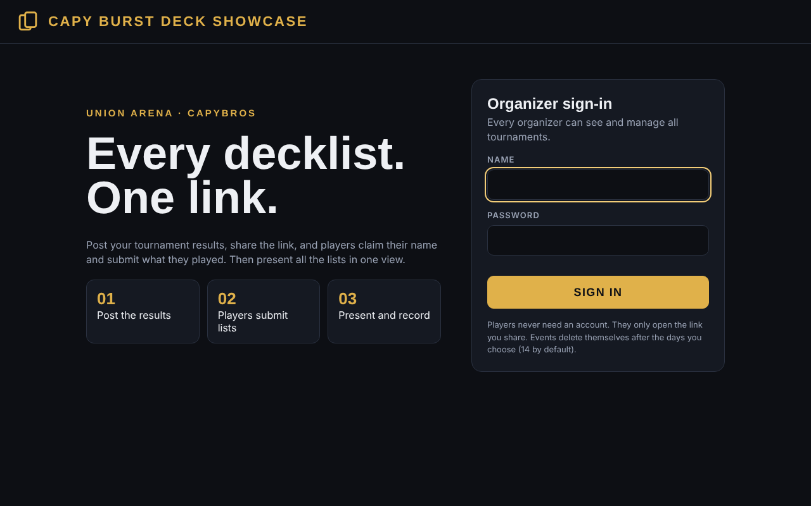
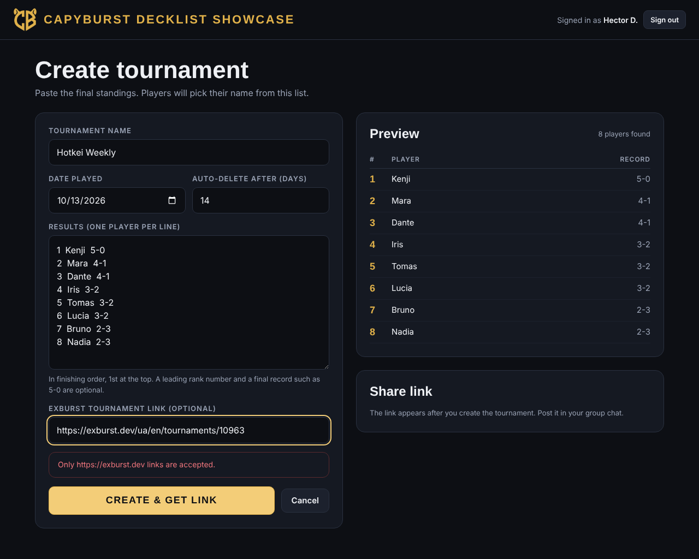
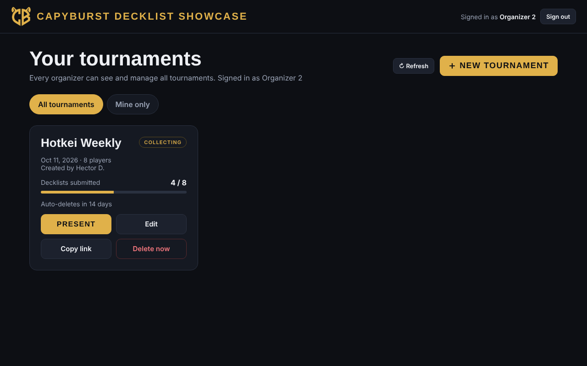
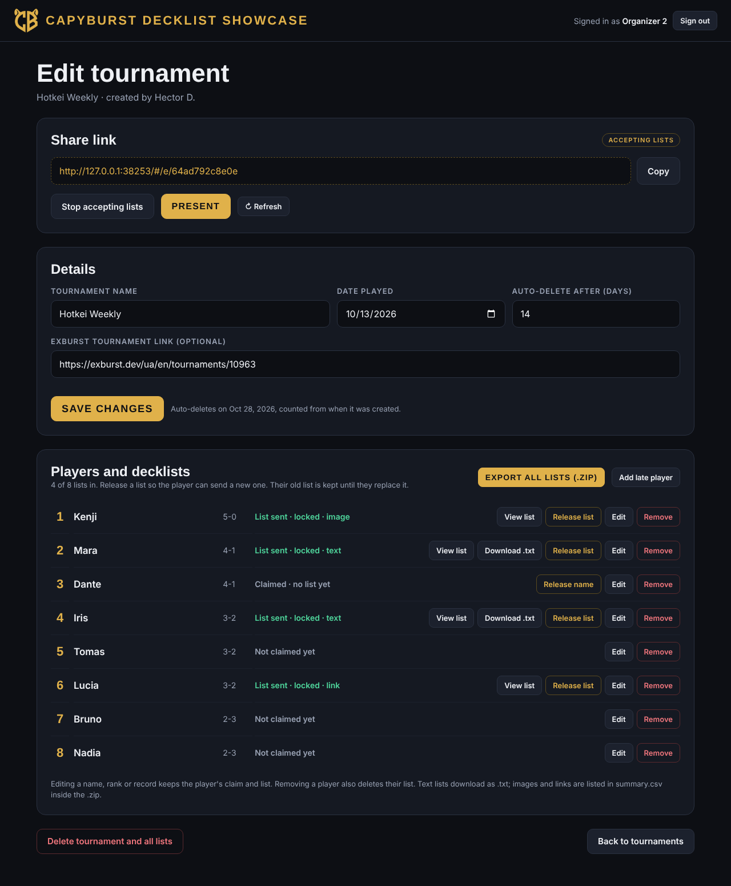
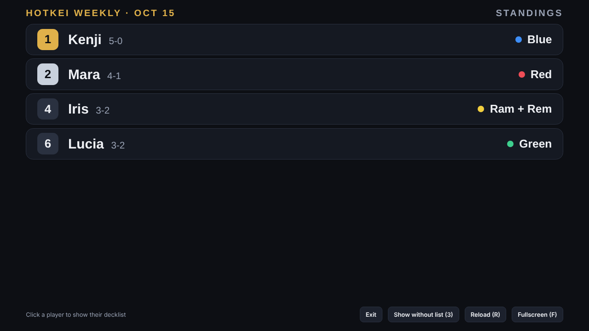
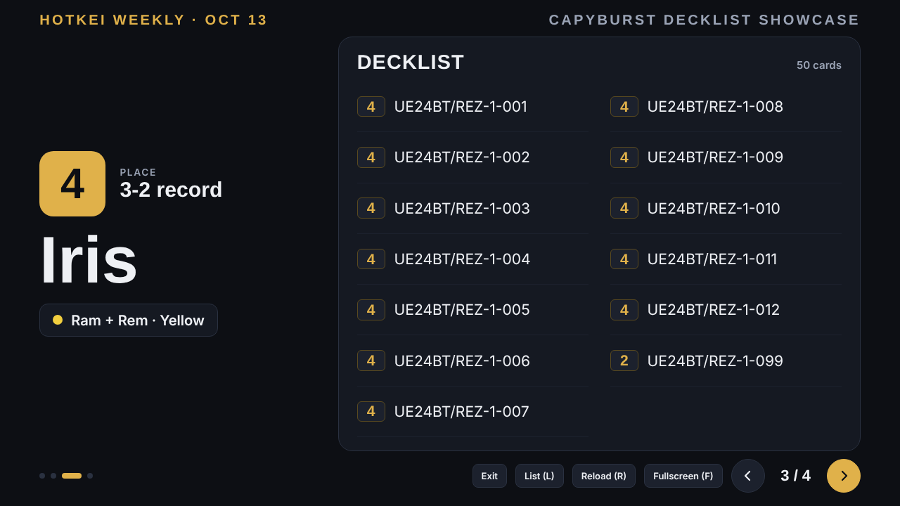
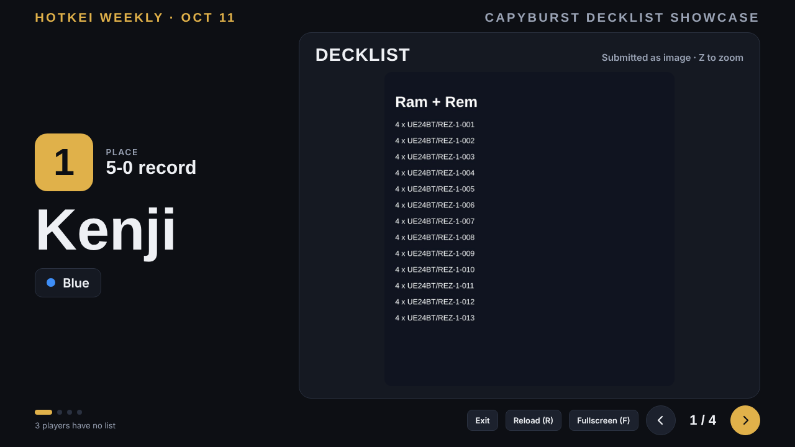
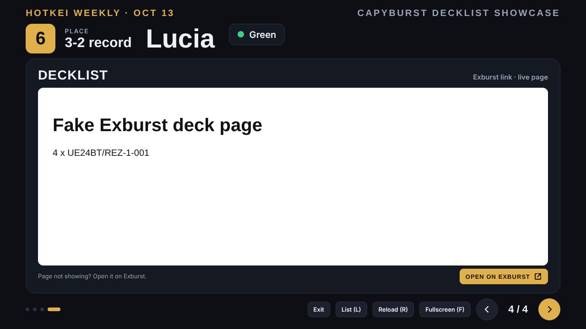
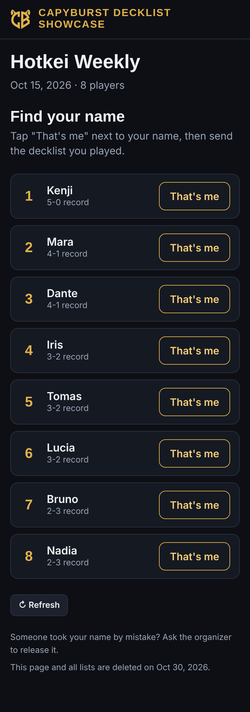
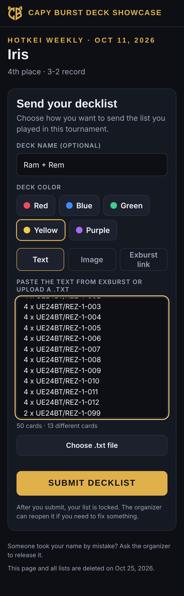

# Guía de usuario — Decklist Showcase v0.1

## Para el organizador

### 1. Entrar
Abre el sitio, escribe tu **nombre** y **contraseña** y pulsa *Sign in*. La sesión dura 6 horas. Después de 5 intentos fallidos se bloquea 15 minutos.



### 2. Crear un torneo
1. *New tournament*.
2. Nombre, fecha, días de auto-borrado (14 por defecto) y, si quieres, el link del torneo en Exburst.
3. Pega los resultados de la app de Bandai, un jugador por línea y en orden de posición. El número de rango y el récord final (`5-0`) son opcionales:
   ```
   1  Kenji  5-0
   2  Mara   4-1
   ```
4. Revisa la vista previa y pulsa **Create & get link**. Copia el link y pégalo en el grupo.



### 3. Seguir el avance
El panel muestra cuántas listas llevan y cuándo se borra cada torneo. *Mine only* filtra los tuyos.



### 4. Editar, liberar y exportar
- **Release name**: libera un nombre reclamado por error.
- **Release list**: reabre la lista para que el jugador envíe otra. La anterior se conserva y se sigue presentando hasta que llegue la nueva. *Undo release* la vuelve a bloquear.
- **Edit**: cambia nombre, rango o récord sin perder el reclamo ni la lista. **Add late player** agrega a alguien que faltó.
- **View list / Download .txt**: ver o bajar la lista tal como la envió el jugador (para cargarla en Exburst si la mandó como texto).
- **Export all lists (.zip)**: todos los `.txt` más `summary.csv` (rango, jugador, récord, mazo, color, tipo y links). Las imágenes no van en el zip: se ven en la presentación o con *View list*.
- **Stop accepting lists**: cierra los envíos.



### 5. Presentar y grabar
Pulsa **Present**. Si un jugador envió un link de Exburst, su slide muestra la página de Exburst dentro de la presentación (con botón *Open on Exburst* de respaldo). Primero verás el **listado por posiciones** con el nombre y el deck de cada jugador (solo los que enviaron lista; con **Show without list** de la barra de abajo puedes ver también a los demás, atenuados). Haz clic en un jugador para mostrar su decklist; con **List (L)** vuelves al listado.



| Tecla | Acción |
|---|---|
| → / Espacio / Re Pág | Siguiente |
| ← / Av Pág | Anterior |
| F | Pantalla completa |
| Z | Ampliar la imagen (otra vez, o Esc, para cerrar) |
| L | Volver al listado |
| Esc | Cierra la imagen ampliada; luego vuelve al listado; en el listado, sale (si no estás en pantalla completa) |

Los botones se ocultan solos en pantalla completa si no mueves el mouse. Las imágenes se precargan; si una tarda, verás "Loading photo…".





Las listas enviadas como **link de Exburst** no se pueden mostrar dentro de la página: aparece un botón *Open on Exburst* que abre la lista en otra pestaña.

### 6. Borrar
Los torneos se borran solos al vencer. *Delete now* los borra de inmediato junto con sus listas y fotos (no se puede deshacer).

## Para los jugadores (texto que puedes pegar en el grupo)
1. Abre el link y toca **That's me** junto a tu nombre. Confirma.
2. Escribe el nombre del mazo (opcional) y elige el color.
3. Envía la lista de **una** de estas formas:
   - **Text**: en Exburst usa *Export > Copy the list* y pégalo (o sube el `.txt`).
   - **Image**: el PNG de Exburst (*Export > Image*) o una captura/foto clara.
   - **Exburst link**: el link de tu mazo (`https://exburst.dev/.../deck/...`).
4. Pulsa **Submit decklist**. Queda bloqueada; si te equivocaste, pide al organizador que la reabra.

Importante: usa siempre el mismo celular/navegador. Si cambias de dispositivo, el organizador debe liberar tu nombre.

**Guardar como app:** en iPhone (Safari) toca Compartir > *Agregar a pantalla de inicio*; en Android (Chrome) menú ⋮ > *Instalar app* / *Agregar a pantalla de inicio*. Aparecerá con el logo de CapyBros.




## Problemas frecuentes
| Síntoma | Qué hacer |
|---|---|
| "Can't reach the server" | Revisa la conexión y reintenta. |
| "The server is busy" | Alguien más estaba escribiendo; espera unos segundos y reintenta. |
| "Your session expired" | Vuelve a iniciar sesión. |
| El nombre ya está reclamado | Pide al organizador *Release name*. |
| La primera carga tarda | Google "despierta" el servidor; puede tardar varios segundos. |
